# Оценка 3

Проверка текущей ветки и состояния репозитория (`git status`):

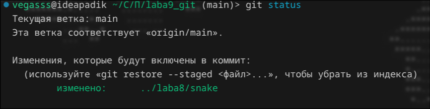

Просмотр истории коммитов (`git log`):

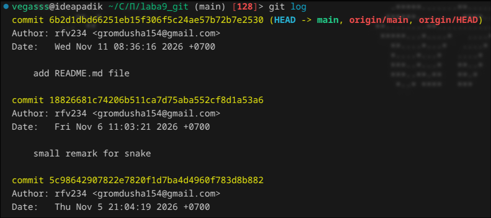

Создание файла `sort.c` с функцией сортировки, проверка статуса и добавление в индекс (`git add sort.c`):

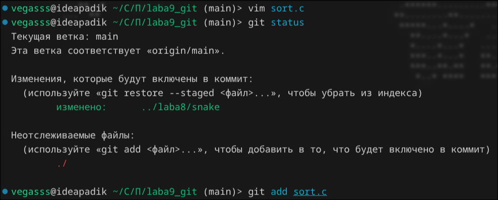

Проверка статуса после индексации и первый коммит файла `sort.c`:

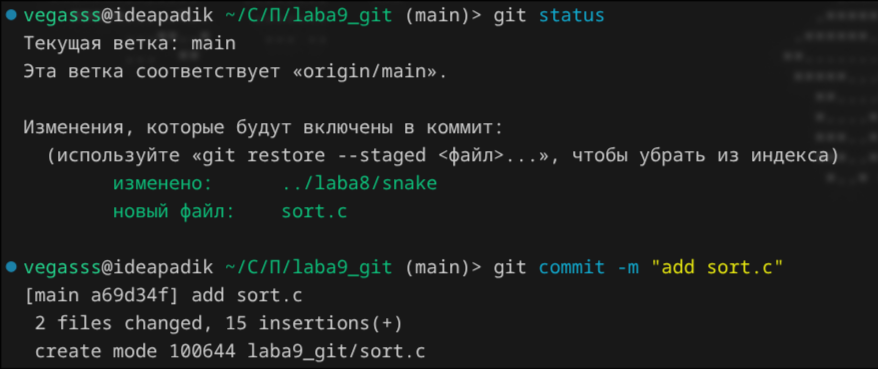

Проверка статуса и добавление первого комментария в `sort.c`:

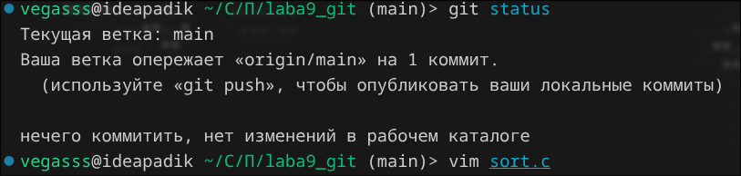

Проверка статуса изменённого файла и его индексация (`git add sort.c`):

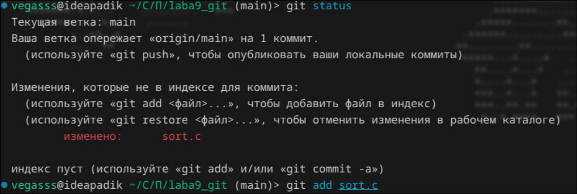

Повторное изменение файла `sort.c` и коммит первой проиндексированной версии:

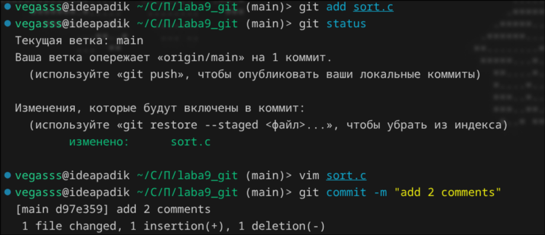

Проверка статуса (`git status`) — в файле осталась неиндексированная правка:

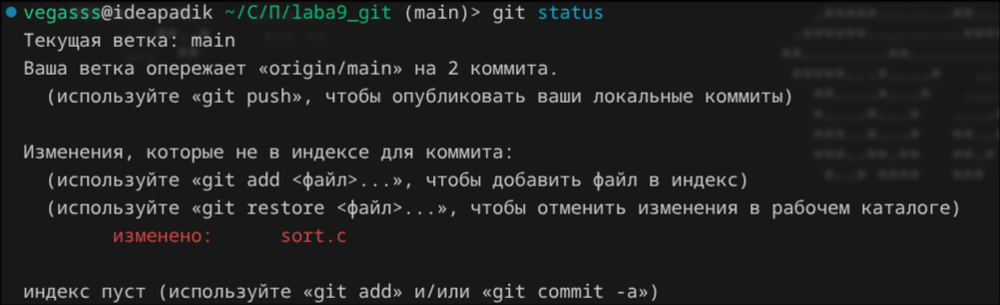

Просмотр журнала коммитов (`git log`):

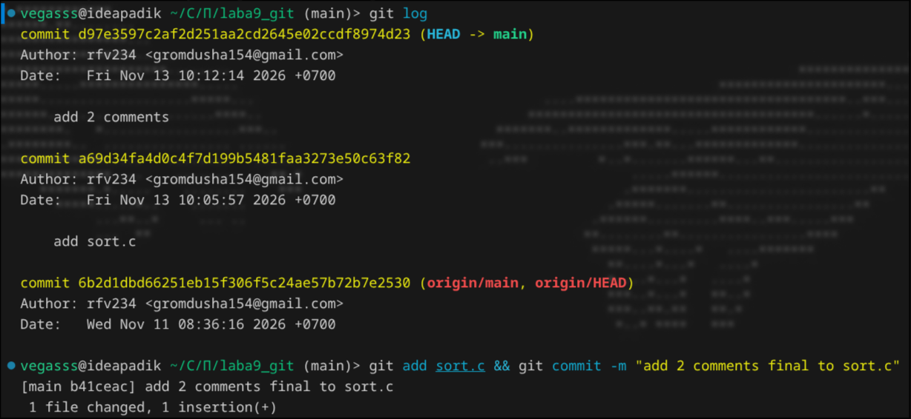

Индексация и коммит последнего изменения в `sort.c`:

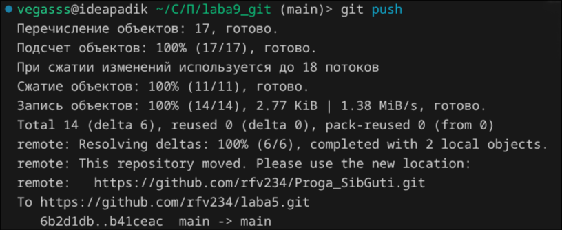

Отправка изменений на удалённый репозиторий (`git push`):

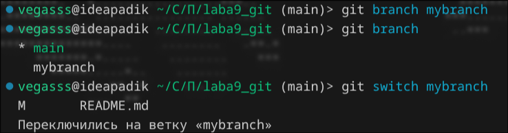

### Ветки

Создание новой ветки `mybranch`, проверка списка веток и переключение на неё (`git switch mybranch`):

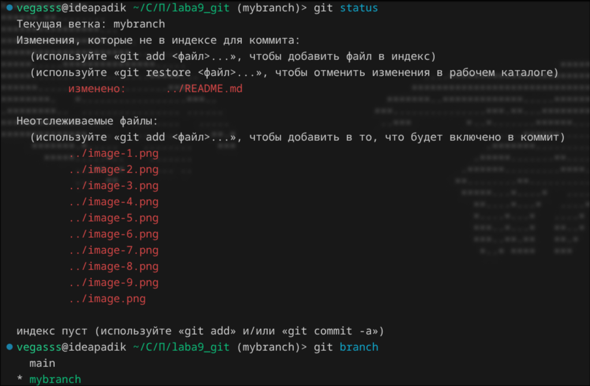

Проверка `git status` и текущей активной ветки (`git branch`):

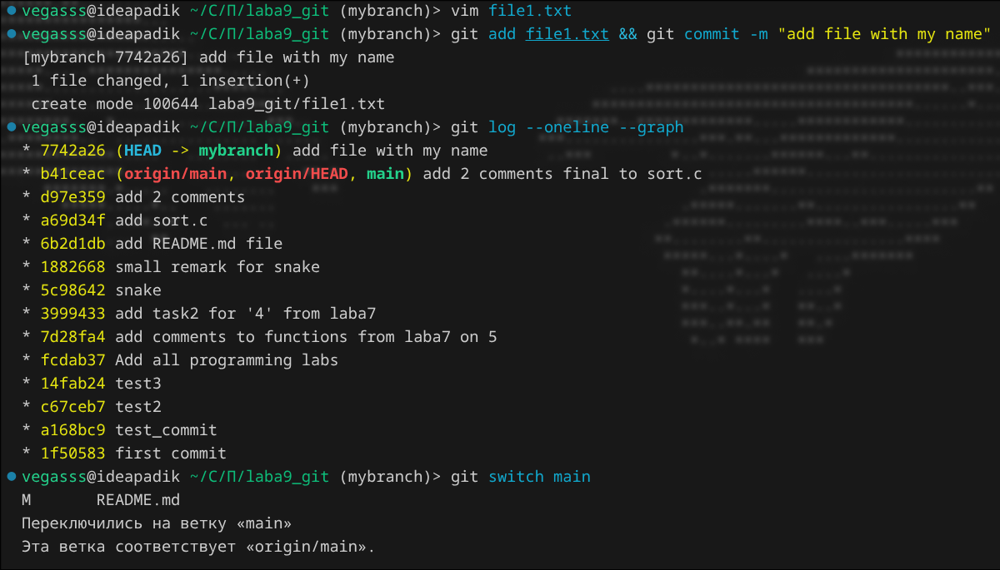

Создание файла `file1.txt` со своим именем, коммит и просмотр графа коммитов:

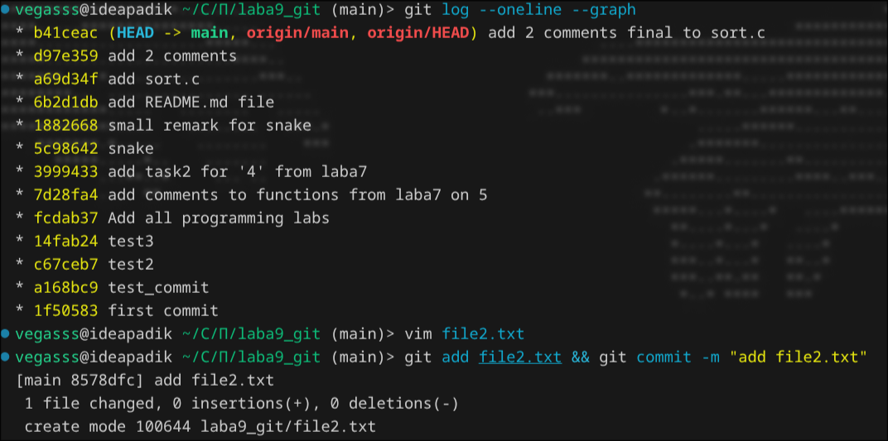

Проверка графа истории и возврат на ветку `main`:

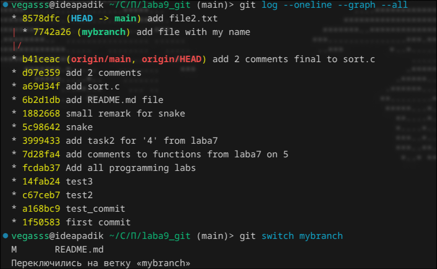

Просмотр истории на ветке `main`, создание и коммит файла `file2.txt`:

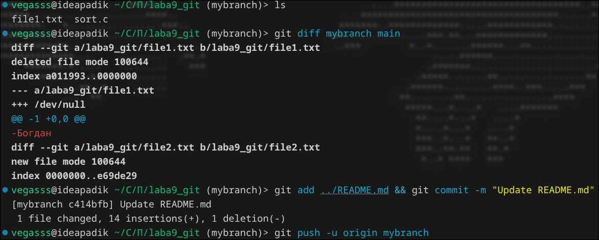

Просмотр общего графа всех веток (`git log --oneline --graph --all`) — ветки `main` и `mybranch` указывают на разные коммиты:

